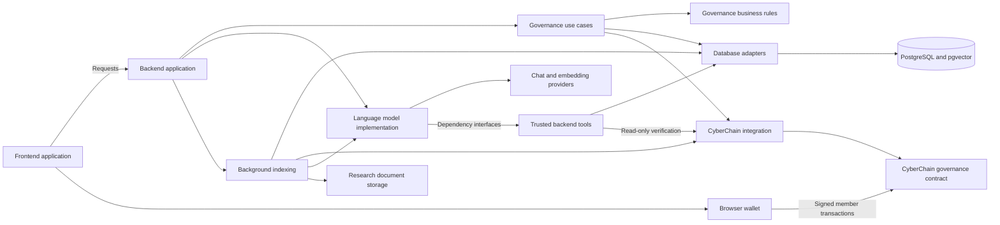

# DAO Platform - Revised Descriptive Architecture

Status: proposal only; reviewed on 13 October 2026. This supersedes the earlier apps/packages/llm layout.

Names should explain responsibility on sight. Only architecture documentation has
been updated; existing code, folders, configuration and data remain in place.

## 1. Recommended folder structure

```text
dao-platform/
|-- frontend-application/
|   `-- src/
|       |-- app/                                  Next.js route convention
|       |-- proposal-management/
|       |-- proposal-voting/
|       |-- proposal-member-assignment/
|       |-- governance-question-answering/
|       |-- research-execution-history/
|       |-- blockchain-wallet-integration/
|       |-- blockchain-transaction-inspection/
|       |-- backend-communication/
|       |-- shared-user-interface/
|       `-- date-and-time-formatting/
|-- backend-application/
|   `-- src/
|       |-- environment-configuration/
|       |-- request-error-handling/
|       |-- service-health-monitoring/
|       |-- governance-proposal-management/
|       |-- governance-question-analysis/
|       |-- research-documents-and-datasets/
|       |-- research-execution-records/
|       |-- trusted-governance-data-tools/
|       |   |-- database-query-tools/
|       |   |-- blockchain-evidence-tools/
|       |   |-- governance-rule-checking-tools/
|       |   `-- document-evidence-search/
|       |-- infrastructure-connections/
|       |   |-- database/
|       |   |-- blockchain/
|       |   `-- document-storage/
|       `-- background-processing/
|           |-- blockchain-governance-indexing/
|           `-- research-document-indexing/
|-- large-language-model-implementation/
|   `-- src/
|       |-- analysis-data-types/
|       |-- dependency-interfaces/
|       |-- model-provider-integrations/
|       |   |-- ollama/
|       |   |-- gemini/
|       |   `-- groq/
|       |-- answering-strategies/
|       |-- agent-task-execution/
|       |-- question-understanding-and-routing/
|       |-- question-answering-workflows/
|       |-- document-retrieval-and-answering/
|       |-- evidence-based-answer-generation/
|       |-- answer-claim-verification/
|       |-- language-model-prompts/
|       |-- read-only-tool-execution/
|       `-- request-deadlines-and-call-limits/
|-- shared-modules/
|   |-- governance-business-rules/
|   |-- governance-use-cases/
|   |-- database-persistence/
|   |-- cyberchain-blockchain-integration/
|   |-- governance-smart-contracts/
|   `-- frontend-backend-data-contracts/
|-- deployment-configuration/
|-- smart-contract-deployment-records/
|-- project-documentation/
|-- repository-maintenance-scripts/
|-- local-runtime-data/                            ignored generated data
|-- package.json
|-- package-lock.json
`-- readme.md
```

The model library runs inside backend initially. Separate source folders do not
require separate servers. shared-modules contains reusable business rules,
persistence, chain integration and browser-safe payload contracts.

## 2. Naming rules and corrections

- Use lowercase descriptive English names with hyphens.
- Name folders for their responsibility and files for subject/action plus role.
- Avoid generic lib/common/utils/helpers and ai/llm/rag/dto abbreviations in custom responsibility names.
- Keep meaningful technology/brand names: PostgreSQL, CyberChain, Ollama, Gemini and Groq.
- Preserve standard tool/framework filenames: package.json, tsconfig.json, next.config.ts, nest-cli.json, index.ts, page.tsx, layout.tsx and route.ts. src/app stays a Next.js convention.
- Use descriptive Next.js route groups where useful, preserving public URLs.
- Do not create empty layers or a separate file per word in a responsibility.

| Previous name | Revised name | Purpose |
| --- | --- | --- |
| apps/frontend | frontend-application | Browser application |
| apps/backend | backend-application | Server application |
| packages/llm or LLM | large-language-model-implementation | Model providers, retrieval and reasoning |
| packages | shared-modules | Reusable modules |
| domain | governance-business-rules | Governance entities/invariants |
| application | governance-use-cases | Business workflows |
| ports | dependency-interfaces | Required interfaces implemented by adapters |
| contracts | governance-smart-contracts | Solidity governance enforcement |
| api-contracts | frontend-backend-data-contracts | Browser/server request and response payloads |
| lib/api | backend-communication | Backend requests from frontend |
| features/ai | governance-question-answering | Question/answer user interface |
| rag | document-retrieval-and-answering | Retrieve document evidence and answer from it |
| synthesis | evidence-based-answer-generation | Construct answers using evidence |
| runtime | request-deadlines-and-call-limits | Timeouts, cancellation, model budgets |
| infra | deployment-configuration | Operational configuration |
| docs/adr | project-documentation/architecture-decisions | Recorded decisions |

## 3. File naming examples

| Current name | Descriptive proposed filename |
| --- | --- |
| main.ts | bootstrap-backend-server.ts |
| app.module.ts | backend-application.module.ts |
| ai.controller.ts | governance-question-analysis.controller.ts |
| ai.dto.ts | analyze-governance-question.request.ts |
| ai-panel.tsx | governance-question-and-analysis-mode-panel.component.tsx |
| vector-rag.system.ts | answer-with-retrieved-document-evidence.service.ts |
| chunking.service.ts | split-document-text-into-searchable-chunks.service.ts |
| direct-plan.ts | plan-recognized-governance-question.ts |
| evidence-fusion.ts | combine-tool-evidence-and-answer-statements.ts |
| mcp.adapter.ts | model-context-protocol-tool.adapter.ts |
| request-budget.ts | governance-analysis-request-limits.ts |
| ollama.client.ts | Split into descriptive Ollama/Gemini/Groq chat/embedding providers |

Role suffixes explain file type: controller, service, request, repository, adapter,
interface, types, component. Preserve class/export identities initially when moving
files; public names and paths require explicit compatibility review.

## 4. Responsibilities and dependency boundaries

| Area | Owns |
| --- | --- |
| Frontend application | Screens, wallet connection, backend requests and answer display |
| Backend application | HTTP validation, authorization, trusted scope, infrastructure wiring, research persistence and background jobs |
| Model implementation | Chat/embedding integrations, prompts, routing, RAG algorithms, agent execution, evidence-backed answers and verification |
| Governance business rules | Entities, wallet values and governance invariants |
| Governance use cases | Create/publish/assign/vote/synchronize workflows and dependency interfaces |
| Database persistence | PostgreSQL repositories/SQL/migrations, vectors and SQLite importer |
| CyberChain blockchain integration | Contract calls, event normalization and deployment integration |
| Governance smart contracts | On-chain enforcement in Solidity |
| Frontend/backend data contracts | Stable browser-safe request/response types |

Model implementation must not import backend services, NestJS or concrete database
connections. Backend supplies trusted scope and registered read-only tool adapters.
Pure governance compliance rules belong in business rules/use cases and are exposed
through backend tools. Models do not calculate authoritative totals or authorize votes.
Keep research recording in backend and one canonical read-only tool registry.

## 5. Proposed runtime view



The chain is authoritative for confirmed governance. Database stores drafts, indexed
governance, research runs and retrieval chunks. Storage holds verified document bytes.

## 6. Additional project improvements

- Current locations remain apps/web, apps/api and packages/*; AI remains under apps/api/src/ai.
- Refresh README: current API requires POSTGRES_URL, uses PostgreSQL and Compose includes pgvector; README still describes SQLite as the active read model.
- Split the broad OllamaClient and explicitly validate resolved chat/embedding configuration. Groq currently uses Ollama embeddings.
- Align port documentation/defaults: README/API environment default mention 3000; Next.js proxy defaults to 3002.
- Share payload types without exposing server/provider internals; runtime request validation remains necessary.
- Preserve vector(1024) compatibility and model identities; provider/model changes need planned re-indexing.
- Extend existing research traces with consistent request/run IDs and failure categories.
- Add focused CI and AI evaluations during implementation. API lint currently uses --fix; CI should use non-mutating lint.
- Split workers and add durable job claims only when load/multiple replicas requires it.

## 7. Future implementation order

1. Agree on names and record the architecture decision.
2. Introduce payload contracts and dependency interfaces.
3. Rename source locations in focused changes; update imports, exports, build/test settings and scripts.
4. Extract providers/model workflows while retaining HTTP, SQL, storage and concrete tools in backend/database modules.
5. Preserve API URLs, external mode strings, package identities, Solidity names and recorded migration identities.
6. Verify existing wallet/API/research/model behavior and new adapter boundaries.
7. Reorganize deployment/data paths separately; add workers only when needed.

Root workspaces would include frontend-application, backend-application,
large-language-model-implementation and shared-modules/*. Renaming main.ts needs
Nest entryFile/build/start settings updated. Next.js route groups preserve URLs.
No build, lint, model calls, migrations or application tests were run for this proposal.

## 8. File plan and current references

See [descriptive file-level plan](architecture-files.md) for actual proposed filenames,
source mappings and existing package inventories. No filesystem migration was performed.

- [Current workspace scripts](../package.json)
- [Current frontend configuration](../apps/web/next.config.ts)
- [Current backend composition](../apps/api/src/app.module.ts)
- [Current AI composition](../apps/api/src/ai/ai.module.ts)
- [Current provider selection](../apps/api/src/ai/ai-provider.config.ts)
- [Current provider client](../apps/api/src/ai/ollama.client.ts)
- [Current database package](../packages/database/package.json)
- [Current Compose configuration](../docker-compose.yml)
