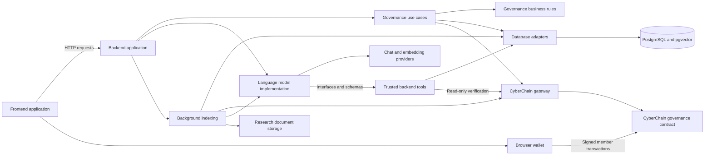

# DAO Platform - Implemented Descriptive Architecture

Status: structural migration implemented on 13 October 2026.

Frontend, backend, language-model implementation and shared modules now have separate
workspaces with descriptive source folders/files. Existing governance and model behavior
is preserved. Package identifiers, public routes, mode strings and persisted migration
identities remain compatible.

## Repository layout

```text
dao-platform/
|-- frontend-application/                 Next.js browser application
|-- backend-application/                  NestJS server and background jobs
|-- llm-implementation/  Model integrations, prompts and answer workflows
|-- shared-modules/
|   |-- governance-business-rules/
|   |-- governance-use-cases/
|   |-- database-persistence/
|   |-- cyberchain-blockchain-integration/
|   |-- governance-smart-contracts/
|   `-- frontend-backend-data-contracts/
|-- deployment-configuration/
|-- smart-contract-deployment-records/
|-- project-documentation/
|-- repository-maintenance-scripts/
|-- data/                                 Existing local runtime data retained
|-- package.json
`-- package-lock.json
```

See [complete current file inventory](architecture-files.md),
[verification report](architecture-migration-report.md) and
[original-to-current path mapping](architecture-migration-map.json).

## Naming conventions

Custom folders describe a responsibility. Custom filenames describe a subject/action
and role: create-governance-proposal.request.ts, list-governance-proposals.tool.ts,
generate-chat-response-with-gemini.provider.ts and governance-proposal.entity.ts.
Generic lib/common/ports/ai/rag folder names were replaced in source organization.

Framework/tool names remain conventional: src, app, page.tsx, layout.tsx, route.ts,
index.ts, package.json, tsconfig.json, next.config.ts and nest-cli.json. Descriptive
Next.js route groups identify purpose without changing public URLs.

Existing exported classes such as OllamaClient, AiController and MultiAgentSystem keep
their identifiers for compatibility; source filenames are now descriptive. Solidity
contract names and the compiler's logical source identity remain stable.

## Ownership

| Workspace | Responsibility |
| --- | --- |
| Frontend | Proposal management/voting/member screens, connected wallets, question/answer UI, research history and backend requests |
| Backend | HTTP handling, trusted scope/authorization, dependency wiring, concrete SQL/RPC tools, storage and indexing |
| Language models | Provider calls, configuration resolution, prompts, question planning, agent execution, constrained synthesis and request budgets |
| Business rules | Governance entities and wallet values |
| Use cases | Create/publish/assign/vote/synchronize workflows and interfaces |
| Database | PostgreSQL SQL/repositories/migrations, vector storage and SQLite compatibility/import |
| Blockchain integration | Contract gateway, interface, canonical events and deployment tooling |
| Smart contracts | Solidity governance rules |
| Data contracts | Public payload types imported by frontend and backend |

## Model/backend boundary

The model library does not import backend source files. Tool inputs/results and schemas
were extracted into canonical read-only-tool-contract modules; backend tools import and
re-export them. The library uses a document-evidence retrieval interface; backend binds
DOCUMENT_EVIDENCE_SEARCH to its existing retrieval service. Database/RPC execution,
file storage and research-run persistence remain backend responsibilities.

Ollama, Gemini and Groq chat methods, plus Ollama/Gemini embedding methods, now live in
provider-specific files. The compatibility client retains caching, retry/deadline logic,
health checks and provider selection. Groq still uses Ollama embeddings.

Existing NestJS injection metadata and ConfigService compatibility are retained in this
first structural migration. Full framework independence would be a separate refactor.
Verification stays within the existing coordinator and controller workflows retain
existing implementations; no empty layers or artificial new services were introduced.

## Runtime view



The chain remains authoritative for confirmed governance. PostgreSQL holds drafts,
indexed governance, research records and chunks. Verified artefact bytes remain under
existing data paths. Source separation does not introduce another model HTTP server.

## Runtime compatibility

- Frontend routes remain /, /analysis, /ai-assistant/results/[runId] and /api/cyberchain/rpc; the same-origin backend proxy still uses /api/v1.
- Existing model modes remain llm-only, vector-rag, multi-agent, hybrid and hybrid-verified.
- Backend root .env loading now uses ../.env from the one-level workspace; artefact defaults use ../data/artefacts to preserve the original repository data location.
- Persisted database migration IDs/order and historical provenance values are unchanged. Source migration filenames can now be descriptive.
- Compose explicitly retains project name dao-platform so moving its file does not change named volume identity.
- Existing npm package identifiers and dev:web/dev:api commands remain supported. Descriptive aliases are dev:frontend/dev:backend and build:shared-modules.
- data/ stays in place. A local-runtime-data rename, separate workers, new auth behavior, new model modes and vector-dimension changes were not introduced.

## Commands

```powershell
npm.cmd run dev:frontend
npm.cmd run dev:backend
npm.cmd run build
npm.cmd run typecheck
```

Set DAO_API_ORIGIN to match backend PORT; the proxy default is http://127.0.0.1:3002.
Database CLI commands require POSTGRES_URL in process environment. Existing data and
signing credentials are not moved or replaced by this structural migration.
